# UML Class Diagram & Object-Oriented Architecture

This document presents the Object-Oriented design and UML class diagram for the **Government Hospital Emergency Resource Allocation System**.

---

## 1. Mermaid UML Class Diagram

```mermaid
classDiagram
    %% Core Domain Models
    class Severity {
        <<enumeration>>
        CRITICAL
        SERIOUS
        MINOR
        -int rank
        -String displayName
        +getRank() int
        +getDisplayName() String
    }

    class Patient {
        -String patientId
        -String name
        -int age
        -String gender
        -Severity severity
        -String requiredFacility
        -long arrivalSequence
        -LocalDateTime arrivalTime
        -Status status
        -String assignedHospitalId
        -String assignedBedId
        -String assignedDoctorId
        -String referralNotes
        +compareTo(Patient other) int
        +setSeverity(Severity severity) void
        +setStatus(Status status) void
        +getSeverity() Severity
        +getRequiredFacility() String
    }

    class Bed {
        <<abstract>>
        -String bedId
        -String hospitalId
        -String bedNumber
        -boolean occupied
        -String currentPatientId
        +admitPatient(String patientId) void
        +dischargePatient() void
        +supportsRequirement(String facilityRequirement)* boolean
        +getBedType()* String
        +isOccupied() boolean
    }

    class GeneralBed {
        -boolean hasOxygenSupport
        +supportsRequirement(String facilityRequirement) boolean
        +getBedType() String
    }

    class ICUBed {
        -boolean hasVentilator
        -boolean hasAdvancedTelemetry
        +supportsRequirement(String facilityRequirement) boolean
        +getBedType() String
    }

    class Doctor {
        -String doctorId
        -String name
        -String specialization
        -String hospitalId
        -boolean onDuty
        -String assignedPatientId
        +setDutyStatus(boolean onDuty) void
        +admitPatient(String patientId) void
        +dischargePatient() void
        +canTreat(Severity severity, String facilityRequirement) boolean
        +isOnDuty() boolean
        +isAvailable() boolean
    }

    class Hospital {
        -String hospitalId
        -String name
        -String locationId
        -boolean isPrimary
        -Map~String, Bed~ beds
        -Map~String, Doctor~ doctors
        +addBed(Bed bed) void
        +addDoctor(Doctor doctor) void
        +findAvailableBed(String facility) Optional~Bed~
        +findAvailableDoctor(Severity s, String f) Optional~Doctor~
        +admitPatient(Patient p, Bed b, Doctor d) void
        +dischargePatient(String patientId) boolean
    }

    class AdmissionRequest {
        -String requestId
        -LocalDateTime timestamp
        -Patient patient
        -String requestedHospitalId
        -Disposition disposition
        -String allocatedHospitalId
        -String allocatedBedId
        -String allocatedDoctorId
        -int travelTimeMinutes
        -String remarks
    }

    class AuditRecord {
        -long sequence
        -LocalDateTime timestamp
        -EventType eventType
        -String patientId
        -String hospitalId
        -String bedId
        -String doctorId
        -String details
    }

    %% Abstraction & Policies
    class AdmissionPolicy {
        <<interface>>
        +evaluate(Hospital hospital, Patient patient)* PolicyResult
    }

    class StandardAdmissionPolicy {
        +evaluate(Hospital hospital, Patient patient) PolicyResult
    }

    %% Routing & Graph
    class Location {
        -String locationId
        -String name
        -String description
    }

    class RoadEdge {
        -String fromLocationId
        -String toLocationId
        -int travelTimeMinutes
        +setTravelTimeMinutes(int minutes) void
    }

    class RoadGraph {
        -Map~String, Location~ locations
        -Map~String, List~RoadEdge~~ adjacencyList
        +addLocation(Location loc) void
        +addRoad(String u, String v, int travelTime) void
        +updateTravelTime(String u, String v, int newTime) boolean
        +getEdgesFrom(String locId) List~RoadEdge~
    }

    class RoutePlanner {
        +calculateShortestPaths(RoadGraph g, String sourceId) DijkstraResult
    }

    class DijkstraResult {
        -String sourceLocationId
        -Map~String, Integer~ distances
        -Map~String, String~ predecessors
        +getDistanceTo(String destId) int
        +getPathTo(String destId) List~String~
    }

    %% Service Orchestration
    class ReferralService {
        -RoutePlanner routePlanner
        -RoadGraph roadGraph
        +referPatient(Hospital primary, Collection~Hospital~ all, Patient p) ReferralResult
    }

    class HospitalSystemManager {
        -PriorityQueue~Patient~ waitingQueue
        -Map~String, Patient~ allPatients
        -Map~String, Hospital~ hospitals
        -List~AuditRecord~ auditHistory
        -AdmissionPolicy admissionPolicy
        -ReferralService referralService
        -RoadGraph roadGraph
        -Hospital primaryHospital
        +registerPatient(...) Patient
        +processWaitingQueue() List~AdmissionRequest~
        +dischargePatient(String hId, String pId) boolean
        +setDoctorDutyStatus(String hId, String dId, boolean onDuty) boolean
        +updatePatientSeverity(String pId, Severity newSev) boolean
    }

    %% Relationships
    Bed <|-- GeneralBed : Inheritance
    Bed <|-- ICUBed : Inheritance
    Patient o-- Severity : Uses
    Hospital *-- Bed : Composition (HashMap)
    Hospital *-- Doctor : Composition (HashMap)
    AdmissionPolicy <|.. StandardAdmissionPolicy : Implements
    HospitalSystemManager o-- AdmissionPolicy : Uses
    HospitalSystemManager o-- ReferralService : Uses
    ReferralService o-- RoutePlanner : Composition
    ReferralService o-- RoadGraph : Uses
    RoutePlanner ..> DijkstraResult : Produces
    RoadGraph *-- Location : Composition
    RoadGraph *-- RoadEdge : Composition
    HospitalSystemManager *-- Hospital : Composition (HashMap)
    HospitalSystemManager *-- Patient : Composition (HashMap & PriorityQueue)
    HospitalSystemManager *-- AuditRecord : Composition (ArrayList)
    AdmissionRequest o-- Patient : References
```

---

## 2. Mapping to Object-Oriented Principles

| OOP Concept | Project Manifestation | Implementation Details |
| :--- | :--- | :--- |
| **Classes & Objects** | `Patient`, `Bed`, `Doctor`, `Hospital`, `AdmissionRequest` | Concrete and abstract domain abstractions representing public health assets. |
| **Encapsulation** | `Bed` and `Doctor` state mutators | Private fields `occupied`, `currentPatientId`, `onDuty`, and `assignedPatientId` can **only** be modified via `admitPatient()`, `dischargePatient()`, and `setDutyStatus()`. Invariants prevent double allocations or unassigned discharges. |
| **Inheritance** | `GeneralBed` and `ICUBed` extend `Bed` | Subclasses inherit common bed identity and state tracking while extending domain-specific hardware indicators (e.g., oxygen lines, ventilators). |
| **Polymorphism** | `supportsRequirement(facility)` | `Bed` defines an abstract method overridden by `GeneralBed` (matching "General", "Ward", "Observation") and `ICUBed` (matching "ICU", "Ventilator", "Critical"). Callers dynamically dispatch eligibility without checking concrete types. |
| **Abstraction** | `AdmissionPolicy` interface | Decouples the decision of patient admission from concrete hospital entities. Any future clinical triage algorithm (e.g., scoring-based triage) can be plugged in seamlessly. |
| **Composition** | `Hospital` containing `Bed` and `Doctor` | `Hospital` owns and coordinates collections of beds and doctors using `HashMap` lookups by identifier. `ReferralService` is composed with `RoutePlanner` to perform Dijkstra queries. |
